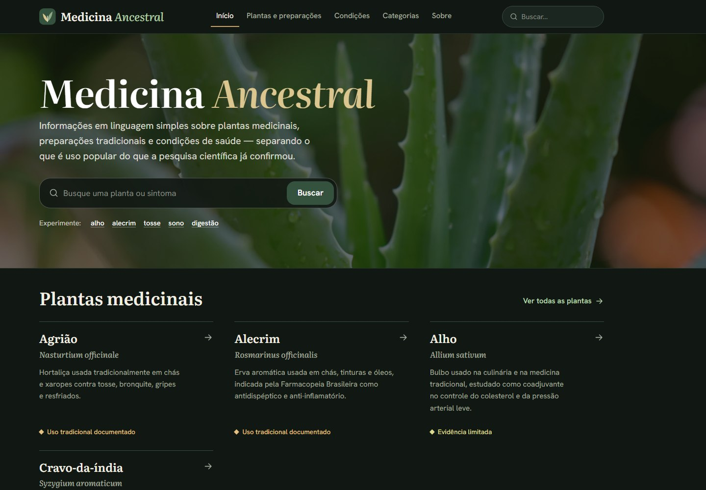
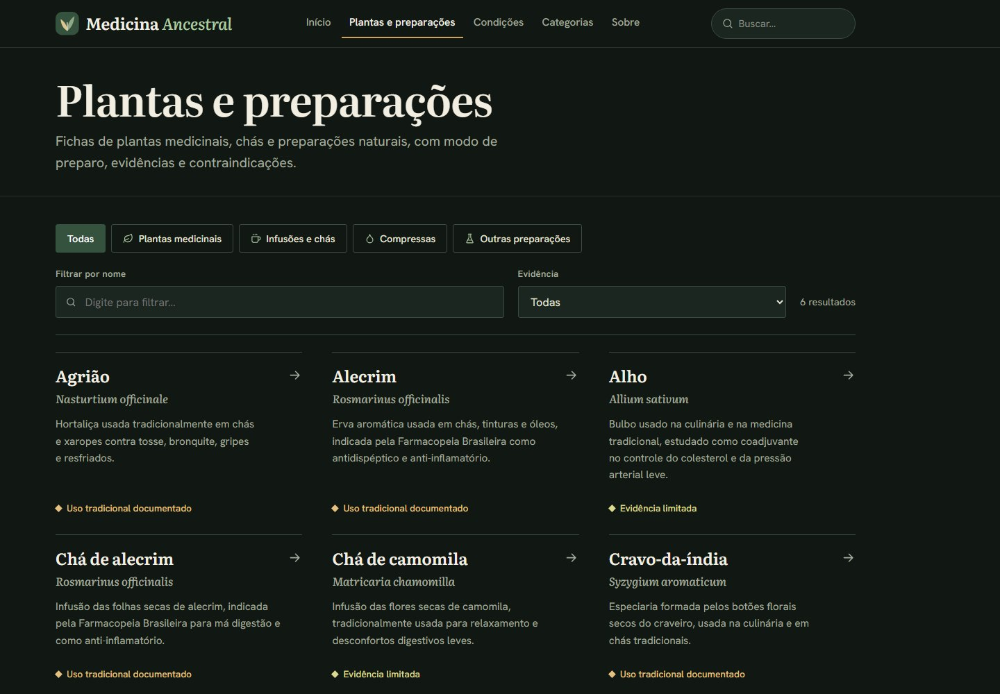
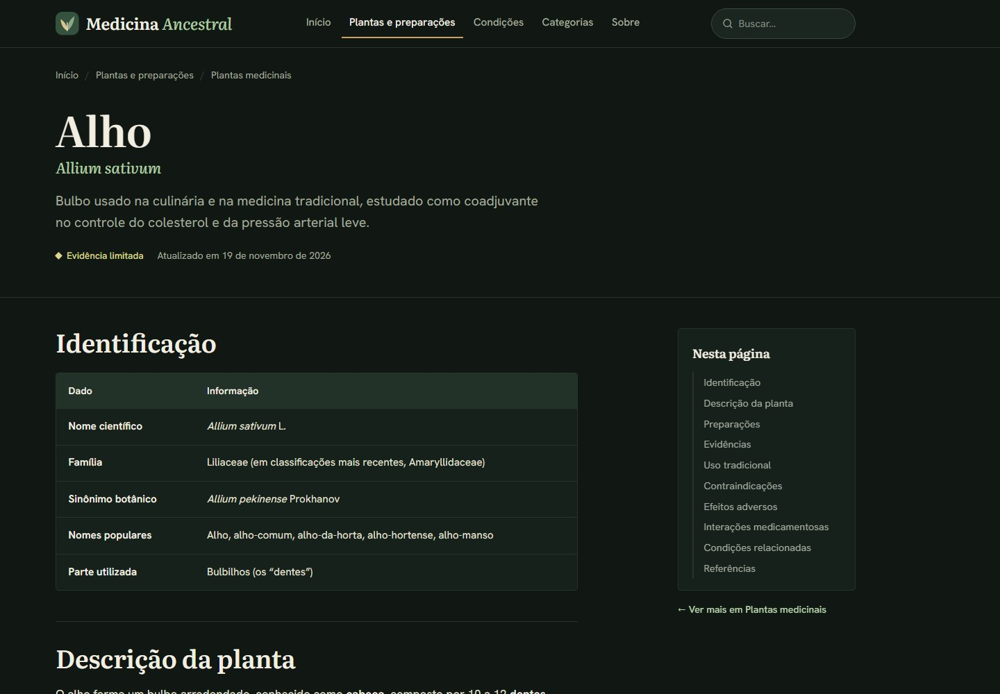
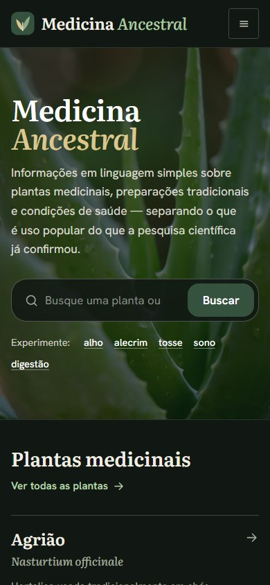

<div align="center">


# Medicina Ancestral

**Saberes das plantas, com ciência e cuidado.**

Informações em linguagem simples sobre plantas medicinais, preparações tradicionais e condições de saúde —
separando o que é uso popular do que a pesquisa científica já confirmou.


<br />



</div>

---

## 🌿 Sobre o projeto

O **Medicina Ancestral** é um site público de educação em saúde. Cada planta, chá ou condição tem
uma página própria com identificação botânica, modo de preparo, contraindicações, interações e
referências — e um selo que mostra **quanta evidência científica existe** para aquele uso.

> [!IMPORTANT]
> O conteúdo é educativo e **não substitui consulta com profissional de saúde**.

## ✨ Destaques

| | |
|---|---|
| 🔎 **Busca instantânea** | Encontra plantas, sintomas e preparações sem diferenciar acentos ou maiúsculas. |
| 🏷️ **Níveis de evidência** | Cada artigo indica se o uso tem evidência consistente, limitada, insuficiente, é só tradicional ou não é recomendado. |
| 📑 **Índice automático** | Os títulos do artigo viram o menu lateral "Nesta página". |
| ⚠️ **Avisos de segurança** | Contraindicações, efeitos adversos e interações medicamentosas em destaque. |
| 🔗 **Conteúdo conectado** | Plantas ligam às condições em que são usadas, e vice-versa. |
| 📱 **Responsivo** | Tema escuro botânico, pensado para leitura no celular. |
| ✍️ **Fácil de editar** | Novos artigos são só arquivos Markdown — sem banco de dados, sem backend. |

<div align="center">
  
  <br /><br />
  
  &nbsp;
  
</div>

## 🌱 Conteúdo atual

- **Plantas medicinais:** Agrião · Alecrim · Alho · Cravo-da-índia
- **Infusões:** Chá de alecrim · Chá de camomila
- **Condições:** Resfriado comum · Insônia

## 🚀 Rodar localmente

Requer [Node.js](https://nodejs.org/) 20.19+ ou 22.12+.

```bash
git clone https://github.com/rckhz/medicina-ancestral.git
cd medicina-ancestral
npm install
npm run dev      # http://localhost:5173
```

| Comando | O que faz |
|---|---|
| `npm run dev` | Servidor de desenvolvimento com recarga automática |
| `npm run build` | Checa os tipos e gera a versão final em `dist/` |
| `npm run preview` | Serve o build localmente para teste |
| `npm run lint` | Verifica o código com oxlint |

## 🗂️ Estrutura

```text
src/
├── components/   Header, Footer, Search, PageHead, Icon, CategoryCard, ContentCard,
│                 EvidenceBadge, ReferenceList, ArticleLayout, MarkdownContent, SafetyNotice…
├── pages/        Home, Conditions, ConditionDetails, Preparations, PreparationDetails,
│                 Categories, SearchResults, About, NotFound
├── content/      artigos .md (conditions/<categoria>/, preparations/<categoria>/)
├── data/         categories.ts — categorias e níveis de evidência
├── lib/          markdown.ts (frontmatter), content.ts (carregamento, validação, busca)
├── types/        content.ts
└── styles/       variables.css (paleta), global.css
```

### Rotas

| Rota | Página |
|---|---|
| `/` | Início |
| `/preparacoes` | Plantas e preparações (filtros `?q=`, `?categoria=`, `?evidencia=`) |
| `/preparacoes/:slug` | Página de uma planta ou preparação |
| `/condicoes` | Condições de saúde (filtros `?q=`, `?categoria=`) |
| `/condicoes/:slug` | Página de uma condição |
| `/categorias` | Todas as categorias |
| `/busca?q=` | Resultados da pesquisa |
| `/sobre` | Sobre o projeto |

<details>
<summary><b>Decisões técnicas</b></summary>

- **Frontmatter:** usamos o pacote `yaml` em vez de `gray-matter`, porque o `gray-matter` depende de APIs do Node (`Buffer`, `fs`) e quebra no navegador.
- **Busca:** local, sem acentos e sem diferenciar maiúsculas; pesquisa título, nomes de plantas, palavras-chave, categoria e texto.
- **Visual:** estilo "botânico editorial" em tema escuro — fontes Literata (títulos) e Hanken Grotesk (texto) via Google Fonts, hero com foto, catálogo em três colunas sem cartões, selos de evidência planos, paleta em `src/styles/variables.css`, ícones SVG próprios em `components/Icon`.

</details>

---

<div align="center">
<sub>Feito com 🌿 para aproximar o saber popular do conhecimento científico.</sub>
</div>
